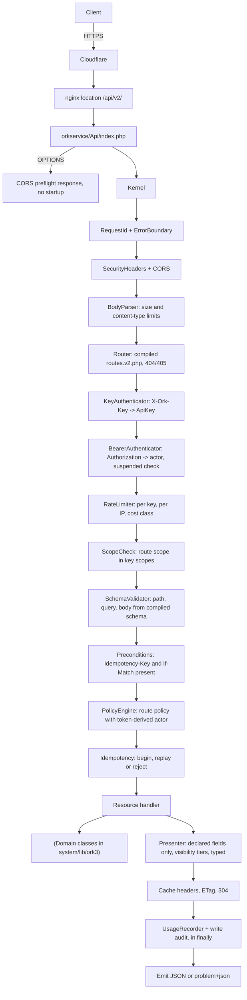

# ORK API v2 — Plan Overview

**Status:** plan, not yet executed; all decisions taken (section 12, 2026-11-24). **Written:** 2026-11-23 against `refactor/api-reconstruction` (upstream master `e2301f2f8` + merge).
**Audience:** the Opus orchestrator that will execute this plan with Sonnet implementers, and the maintainer, whose decisions are recorded in section 12.

Companion files:

| File | Contents |
|---|---|
| `01-resource-catalog.md` | Every v2 endpoint (method, path, scope, policy, visibility, source domain method) and the v1 to v2 mapping |
| `02-phase-1-foundation.md` | Kernel, auth, keys, spec pipeline, docs explorer, reference resource (the interface contract lives here) |
| `02-phase-2-read-fanout.md` | Fan-out task template plus all read-side resource families |
| `02-phase-3-write-fanout.md` | Write-side and complex families (awards, courts, events, surveys, qual tests, credits, admin) |
| `02-phase-4-hardening.md` | Security test suite, abuse controls, usage dashboards, CI gates |
| `02-phase-5-v1-deprecation.md` | v1 monitoring, `Deprecation` header (no `Sunset`), frozen method list, SOAP removal, legacy reference, migration guide |
| `02-phase-6-v1-security-floor-optional.md` | OPTIONAL, unscheduled (v1 risk accepted, U1): closing the severe v1 holes, ready to run if the decision changes |
| `02-phase-7-v1-retirement.md` | DEFERRED, not scheduled (U2): the staged retirement design and its measured criteria, kept as the future path |
| `03-traceability.md` | Inventory finding class to v2 control and task (no exploit detail) |
| `04-standards.md` | Self-documenting API standard, agent-instructions text, Claude rule, hook and CI spec |
| `review-security.md` | Application-security review of this plan: findings by severity, what was changed where, and the decisions left to the user |
| `../inventory/SECURITY-FINDINGS.md` | LOCAL ONLY (git-excluded). Ranked vulnerabilities with specifics |

Nothing in `plan/` contains exploit-level detail. Where a task needs the specific method list it points at the local-only findings file by ID.

**v1 risk acceptance (decision U1, 2026-11-24).** The security review (`review-security.md`) recommended fixing the critical v1 subset (Phase 6 option A) before v2 general availability and before this plan is published. The maintainer has accepted the v1 exposure in writing instead. Scope of the acceptance: the critical and high v1 findings in the local findings file remain open until v1 is retired or a later decision schedules Phase 6. No v1 hotfix is scheduled. This acceptance replaces the earlier publication gate and the U1 item on the go-live checklist (H-14): neither publishing this plan nor v2 GA waits on Phase 6. Phase 6 stays written out in full so it can start within a day if the decision changes. The plan still contains no exploit-level detail.

---

## 1. Goals and non-goals

**Goals**

1. A REST API at `/api/v2`, described by an OpenAPI 3.1 document generated from code, covering the useful surface found in the inventory.
2. v1 (JSON-RPC bridge, the four JSONService endpoints, UI AJAX) keeps working unchanged for its consumers. It is marked deprecated when v2 launches; no retirement date is set (U2), and Phase 7 holds the retirement design for when one is.
3. Every defect class in the inventory is closed in v2 by construction, not by per-endpoint care: one authentication step, one policy layer, one serializer that only emits declared fields, bound SQL parameters only, one error model.
4. ORK Admins issue, scope, rotate, revoke and monitor API keys in the app.
5. An endpoint cannot exist without its documentation. The route table is compiled from the OpenAPI attributes, so an undocumented handler is unreachable, and a pre-commit step plus CI fail on drift.
6. The generated spec is the in-app documentation (RapiDoc explorer), with a legacy v1 reference and a migration guide generated from the same data.

**Non-goals (explicitly out of this plan)**

- Moving the web UI's own AJAX controllers onto v2. They stay; the optional Phase 6 hardens them in place.
- Porting legacy or dead surfaces: Game, legacy Tournament writes, DataSet, the Treasury ledger and account methods, the `ork_application*` third-party app scheme, face lookup, HTML-returning service methods, UI plumbing (banner dismissals, What's New), and the Admin maintenance and server-health operations (table optimisation, log purge, process list and the like stay in the Admin UI only). Listed in the catalog under "Not ported".
- Self-service developer keys and personal access tokens. Keys are admin-issued for v2.0 (decision U7).
- Upgrading the containers' PHP runtime. v2 stays PHP 8.1-compatible; the 8.3/8.4 upgrade is a separate project (U4).
- GraphQL, webhooks, bulk export feeds, field selection (`?fields=`).

---

## 2. Facts the design rests on (verified in code on this branch)

| Fact | Evidence |
|---|---|
| Every `system/lib/ork3/class.X.php` is required and instantiated onto `Ork3::$Lib` on every request | `startup.php:47-69` |
| `mysql_real_escape_string` is a no-op | `startup.php:11-14` |
| The bridge dispatches by reflection over whole classes, with a name-shape rule and a class whitelist as its only filters; neither is a dependable boundary (specifics are in the local findings file) | `system/lib/system/class.JsonServer.php` `call_endpoint`, `validate_method`, `run_call` |
| Class whitelist is 25 names | `orkservice/Json/index.php:19-45` |
| `JSON_NUMERIC_CHECK` on every bridge response | `class.JsonServer.php:211` |
| Session validation reads `ork_session` by bound token; `IsAuthorized` rejects `penalty_box` but not `suspended` | `class.Authorization.php` (HEAD) `:1303-1330`, `:1078` |
| `AuthorizationGate::check(int,string,$id,?string)` is the committable authority facade | `system/lib/ork3/class.AuthorizationGate.php:8` |
| The pre-commit hook unstages `class.Authorization.php` (task F-31 is the one documented exception, with its own procedure) | `.githooks/pre-commit:32-45` |
| The local working-tree change to that file only bypasses the password comparison in login. Authority checks are unaffected | `git diff system/lib/ork3/class.Authorization.php` |
| nginx only executes URIs ending in `.php`; preflight allows GET, POST, OPTIONS and no `Authorization` header; `Access-Control-Allow-Origin: *` is set at server level | `nginx.ork3.config:8`, `:113-136` |
| nginx rewrites `REMOTE_ADDR` from `CF-Connecting-IP` for trusted peers | `nginx.ork3.config:13-37` |
| Containers run PHP 8.1.2; host PHP is 8.5; `composer.json` requires `>=8.2`; `vendor/` is git-ignored and never deployed | `Dockerfile.prod`, `composer.json`, `.gitignore` |
| No CI exists (no `.github/`); GitHub Actions is to be enabled on the fork and upstream (U5) | repo root |
| `ork_session.token` and the vestigial `ork_mundane.token` hold session tokens in clear (F-31 stores digests instead and adds the `suspended` check above) | `class.Authorization.php` (HEAD) `CreateSession`, `persistVestigialToken` |
| Service entry points do not start a PHP session; `orkui/index.php` does | `orkservice/svcutil.php`, `orkui/index.php:41` |
| Revised-frontend pages are selected with `$this->template = '../revised-frontend/X.tpl'` | `orkui/controller/controller.Admin.php:54-78` |
| `ork_application` and `ork_application_auth` are empty locally | read-only query on the `ork` mirror |
| `ork_api_tally` shows at least 15 self-identified third-party clients besides mORK, jsork, Listmancer and BlackspireWaiver, and browser-labelled clients are the largest callers of several bridge methods | read-only query on the `ork` mirror |

The last row matters: v1 consumers include browser single-page apps on other origins, and mobile apps. A key embedded in such a client is not a secret. The key model in section 5 is built around that.

---

## 3. Architecture

### 3.1 Tiers and where code lives

```
/api/v2/...                     nginx location ^~ /api/v2/  ->  orkservice/Api/index.php
orkservice/Api/                 TRANSPORT TIER. No SQL, no business rules.
  index.php                     front controller (answers OPTIONS before startup.php)
  bootstrap.php                 PSR-4 autoloader: Ork\Api\ -> orkservice/Api/src/
  src/Kernel/                   Request, Response, Problem, Router, Kernel, middleware,
                                SchemaValidator, Presenter, Pagination, DomainResult
  src/Auth/                     KeyAuthenticator, BearerAuthenticator, Principal
  src/Policy/                   PolicyEngine, Policies/*
  src/RateLimit/                Limiter, stores
  src/V2/Resources/             handlers, one class per resource family, OpenAPI attributes
  src/V2/Schemas/               schema classes (attributes only, no logic)
  generated/routes.v2.php       COMPILED from attributes, committed, loaded at runtime
  generated/schemas.v2.php      COMPILED, committed
  generated/v1-map.json         COMPILED (v1 method -> v2 operation), committed
  spec/openapi.v2.json          GENERATED OpenAPI 3.1, committed, served to logged-in players (U9)
system/lib/ork3/                DOMAIN TIER. All SQL.
  class.ApiKey.php, class.ApiUsage.php, class.ApiAudit.php, class.ApiIdempotency.php,
  class.ApiFacts.php, class.ApiActorSession.php       (kernel support, Phase 1)
  class.SessionTokenDigest.php  token -> stored digest, shared with the auth class (F-31)
  class.ApiData<Family>.php     new queries a resource family needs (fan-out)
  (existing classes)            reused through their current public methods
tools/api-spec/                 generator + linter (dev/CI only, uses swagger-php from vendor/)
orkui/                          Admin UI for keys and usage; owner confirmation of acting keys; docs explorer; legacy reference
```

The transport tier calls domain classes the same way the bridge and `APIModel` do (`new Player()` then a method call). The layering rule holds: nothing under `orkservice/Api/` may contain SQL, `$DB`, or `DB_PREFIX`. Task F-27 adds a grep gate for this to the spec check, because `bin/check-layering.sh` is not on this branch.

### 3.2 Request flow



Fixed order, one place. A handler never sees a request that has not been authenticated, rate limited, scope checked, validated and policy checked, and never emits a field the schema does not declare.

### 3.3 The spec is the router

Handlers carry swagger-php attributes. `tools/api-spec/build.php` scans them and emits three artifacts in one run: the OpenAPI document, `routes.v2.php` (method + path pattern to `[class, method]`, scope, policy, cost class, cache rule, request schema reference, response schema reference), and `schemas.v2.php` (the validation and presentation schemas). The runtime router loads only `routes.v2.php`. Consequences:

- A public method on a resource class without an operation attribute is not routable. There is no reflection-based dispatch anywhere in v2.
- Authorization is declared in the same attribute that documents it (`x-ork-scope`, `x-ork-policy`). The linter fails the build when either is missing, so "forgot the auth check" is a build error, and the published documentation states the real rule.
- Input validation and output shaping use the documented schemas, so the documentation cannot describe a different contract from the one enforced.
- swagger-php is a dev dependency only. Production loads two plain PHP arrays.

---

## 4. Key decisions

Each decision lists what was rejected and why.

| # | Decision | Rationale | Rejected |
|---|---|---|---|
| D1 | New tier under `orkservice/Api/`, URL `/api/v2/` | `orkservice` is the API layer by the project's own layering rule; a clean path lets nginx and Cloudflare target it | A second `JsonServer` mode (inherits reflection dispatch); routing through `orkui` (session cookies, CSRF surface, page plumbing queries on every call) |
| D2 | Compiled route table from OpenAPI attributes | Makes documentation a precondition of existence; removes reflection dispatch, the root of v1's accidental endpoints | Hand-written route file plus separate YAML spec (drift); spec-first YAML with generated stubs (the team writes PHP, not YAML, and stubs rot) |
| D3 | `zircote/swagger-php` pinned `^5.8` as a dev dependency | Attribute-based, emits OpenAPI 3.1, runs on PHP 7.4 through 8.5 so it works on the host toolchain today. (It would not install in the 8.1 containers from this repository's `composer.lock`, which already needs PHP 8.4.1 for other dev packages; the build and CI therefore run on PHP 8.4+, and only `php -l` runs on 8.1.) Handler files only need attribute syntax, which PHP 8.1 parses; attribute classes are never loaded at runtime | swagger-php 6.x/7.x (require PHP 8.2, cannot run in the containers; revisit in the separate PHP 8.3/8.4 container-upgrade project, U4); hand-rolled attribute scanner (reinvents schema modelling) |
| D4 | Zero runtime Composer dependencies | `vendor/` is not deployed | Framework (Slim, Symfony components): would need a deploy-pipeline change |
| D5 | Resource-oriented paths, snake_case JSON, integer ids, instants as RFC 3339 in UTC, wall-clock event and park times as offset-free local date-times exactly as entered, dates as `YYYY-MM-DD` | Conventional, and typed by schema so `JSON_NUMERIC_CHECK`-style corruption cannot occur | PascalCase to match v1 (carries v1's naming accidents); camelCase (DB and PHP side are snake_case) |
| D6 | Success envelope `{"data":…, "meta":{…}, "links":{…}}`; errors are RFC 9457 `application/problem+json` | One success shape, one error shape, real HTTP status codes | Bare resources (no room for pagination); v1-style `Status` objects |
| D7 | Cursor pagination only, `limit` default 50 max 200 | Stable under concurrent writes; maps to keyset SQL | Offset pagination (drifts; expensive on the attendance and award tables) |
| D8 | Two credentials: `X-Ork-Key` identifies the application, `Authorization: Bearer` identifies the acting player | Separates "which app" (rate limits, scopes, revocation, monitoring) from "which player" (authority). Effective permission is the intersection | Key only (no per-player authority); bearer only (no app identity, no monitoring); OAuth2 authorization-code server (large build, no consumer asks for it yet) |
| D9 | Publishable keys (`ork_pk_`) for browser and mobile apps, secret keys (`ork_sk_`) for servers | Embedded keys are extractable; treating them as identifiers with origin locks and no standalone privilege is honest | One key type treated as secret everywhere |
| D10 | Bearer tokens are `ork_session` tokens, shared with v1. After F-31 they are stored as SHA-256 digests; clients still send the same opaque 32-hex token | A client can adopt v2 one call at a time with the token it already holds; domain methods that self-check a `Token` keep working | New v2-only token table (forces a big-bang client migration and a shadow session for every domain call) |
| D11 | Secret keys may act as their owner (`acts_as_owner`), backed by an ephemeral per-request `ork_session` row. An admin creates such a key as an inactive request; it activates only when the owning player confirms it in-app with password re-entry (5.2) | Bots stop storing a password; the domain layer still receives a real session token; no admin can create a working impersonation credential alone | Passing a trusted actor id into domain methods (would require changing the auth class or every domain method); admin-only issue of acting keys (impersonation primitive, security review C-2) |
| D12 | Authority via `AuthorizationGate::check` and a small named policy set evaluated before the handler | Single choke point; the only place a mundane id is ever compared with a resource | Per-handler ad-hoc checks (v1's failure mode) |
| D13 | Field visibility declared per schema property (`x-ork-visibility`) and applied by the Presenter; undeclared keys are dropped | Fixes `SELECT a.*` style leaks structurally; documents who sees what | Per-handler `unset()` calls |
| D14 | New domain SQL goes in new `class.ApiData<Family>.php` / `class.Api*.php` files with snake_case method names, never as new public methods on the 25 whitelisted classes | A new public method on a whitelisted class becomes a v1 endpoint. Underscore names are refused by the bridge even if such a class were whitelisted by mistake; a test pins both the whitelist and the name rule | Adding paged readers to `Player`, `Report`, etc. |
| D15 | v1 code paths are not refactored. Changes to v1 are additive: usage recording, optional key attribution, deprecation headers, a frozen method list | Byte-compatibility for consumers we cannot coordinate with | Re-implementing v1 on top of v2 (high risk of envelope regressions for no user benefit) |
| D16 | SOAP is removed, not revived | It has been dead since nusoap was removed; every SOAP entry file is a fatal error today | Stub SOAP server returning faults (nobody calls it) |
| D17 | Key lifecycle is managed only in the Admin UI, never through the API | A leaked admin-scoped key must not be able to mint keys | `/admin/api-keys` write endpoints |
| D18 | Rate limiting in memcached with fixed one-minute windows, plus a DB-backed daily quota | memcached is already a hard runtime dependency; Redis is not installed in the images | `ork_rate_limit` table (a row write per request); Redis |
| D19 | RapiDoc pinned to `12.3.0` (published 2026-11-12, same maintainer as 9.x), vendored into `revised-frontend/script/vendor/` and loaded with an SRI hash (decision U13) | OpenAPI 3.1 support arrived in RapiDoc 11.0, and the spec is 3.1, so the 9.x line cannot render it correctly. 12.3.0 is the current line with 3.1 support; F-26 still runs a 3.1 render check with a stop condition | CDN load (third-party script on an authenticated origin); `9.3.8` (pre-3.1, unsuitable); 14.x (too fresh at the time of the decision) |
| D20 | The explorer page (`Route=ApiDocs`) and `GET /api/v2/openapi.json` require an ORK login (any logged-in player); the page is `noindex`; admins may share the spec file out of band (decision U9) | A speed bump against drive-by automated scanning of the spec, **not a security control**: the source is public, so the design keeps assuming the spec is public knowledge, and no control depends on it being private | Public spec and explorer (the earlier default); admin-only docs (third-party developers need it) |
| D21 | Client IP for limits is `REMOTE_ADDR` as rewritten by nginx realip. PHP never reads forwarding headers | One trusted-proxy definition, in nginx | Re-deriving from `CF-Connecting-IP` in PHP (spoofable when the origin is reached directly) |
| D22 | Validation uses a restricted JSON Schema subset implemented in the kernel; the linter rejects request schemas that use unsupported keywords | Keeps the validator small and exact; no dependency | Full JSON Schema validator library (dependency, D4) |
| D23 | Session tokens are hashed at rest by one deliberate, focused change to `class.Authorization.php` (task F-31), which also adds the effective-suspension check to `IsAuthorized` (decision U8) | One read of `ork_session` (a database copy, a backup, an injection on v1) was every live session. Clients send the same token; only storage changes | Leaving storage unchanged and compensating at the v2 boundary only (the earlier default) |
| D24 | Two edits to the shared shell `orkui/template/default/default.theme`, as a documented exception to the rule against changes under `template/default/`: an "API documentation" link in the header's Resources dropdown for logged-in players (U6), and a flag that lets the key pages and the explorer skip third-party scripts (U18). Task F-33 | It is the live shell every page uses, not a legacy page; both edits are small and reversible | An Admin panel card only (no discoverability for developers); leaving the tag manager on pages that reveal or accept keys |

---

## 5. Authentication and key model

### 5.1 Credentials

| Credential | Header | Format | Identifies | Stored |
|---|---|---|---|---|
| App key, publishable | `X-Ork-Key` | `ork_pk_{env}_{prefix12}_{secret32}` | The application | Prefix in clear, `HMAC-SHA256(pepper, full key)` hex |
| App key, secret | `X-Ork-Key` | `ork_sk_{env}_{prefix12}_{secret32}` | The application (server side) | Same |
| Player session | `Authorization: Bearer <32 hex>` | existing `ork_session` token | The acting player | existing table; SHA-256 digest at rest after F-31 (the client-visible token is unchanged) |

`env` is `live` or `test`. The secret part is 32 characters of base62 from `random_bytes` (190 bits). The pepper is a config constant `ORK_API_KEY_PEPPER` read from the environment (pattern already used for other secrets in `config.*.php`); keys cannot be verified without it, so a database dump alone yields nothing usable. High-entropy random keys do not need a slow hash. Comparison is `hash_equals`.

Pepper handling: the pepper is at least 32 random bytes and is never the dev/test default outside `DEV`/`TEST`. If it is missing, short or equal to a known default in production, key verification fails closed (`503 unavailable`) and `bin/api-key` refuses to issue. Each key row records `hash_version`; `ORK_API_KEY_PEPPER_PREVIOUS` lets a key hashed under the previous pepper verify once and be re-hashed under the current one, so the pepper can rotate without reissuing keys. A wrong secret answers `401 invalid_key` whatever the stored key's state, so status is never disclosed to someone holding only a prefix. Revocation and suspension take effect on the next request (any verification cache is busted on change and lives at most 60 s).

Credentials are never accepted in the query string. A request carrying `token`, `Token`, `key` or `x-ork-key` as a query parameter is rejected with `400 credentials_in_query` so clients learn early and tokens stay out of access logs.

### 5.2 Principal

Every request resolves to a `Principal`:

| App | Actor | What it can do |
|---|---|---|
| none | none | `public` endpoints only, at the anonymous per-IP rate |
| publishable key | none | `public` and `key` policy endpoints (person-level public data), at the key's rate |
| publishable key | Bearer player | scopes of the key intersected with the player's authority |
| secret key | none | as publishable, plus endpoints that only need an app identity (`idp:integration`) |
| secret key, `acts_as_owner` | the key owner | scopes of the key intersected with the owner's authority |
| secret key | Bearer player | scopes of the key intersected with the player's authority |

Rules:

- A Bearer token without a key is refused (`401 key_required`). The app must be identifiable for monitoring and revocation.
- A publishable key never carries privilege on its own. Without a Bearer token it reaches only `public` and `key` policies, whatever scopes are stored on it.
- `admin:read`, `admin:write` and `idp:integration` cannot be granted to a publishable key (`Scopes::PUBLISHABLE_FORBIDDEN`). Admin API use therefore needs a secret key as well as an admin's token, so a stolen admin token plus any extractable browser key cannot reach admin routes. `admin:*` can only be granted to a key whose owner is an ORK admin, and it is re-checked on every request (the owner losing admin drops the scope's effect).
- `acts_as_owner` (D11) is restricted because it turns a key into a standing credential for a person (decisions U7 and U15, reconciled 2026-11-24):
  - **Admin request, owner activation.** Keys are admin-issued only, so an ORK admin creates an `acts_as_owner` key, but only as an **inactive request** (`status = 'pending'`, no secret generated). The key activates only when the owning player confirms it in-app (task F-32) after re-entering their password (step-up). No admin, and nobody who has compromised an admin account, can produce a working key that acts as another player without that player's password, and the confirmation is on record (`owner_confirmed_at`, audit `key.owner_confirmed`).
  - **The secret goes to the owner.** The key material is generated at the moment of confirmation and shown once to the owner on the confirmation page; the requesting admin never sees it (see new question N1 in section 12).
  - A request lapses after 7 days unconfirmed (`key.request_expired`); the owner may decline it (`key.owner_declined`) or later revoke an active one from the same page.
  - Secret key only, with a non-empty `allowed_ips` list, a mandatory expiry no more than 365 days out, and never `admin:write`.
  - Changes that widen an active acting key (scopes, IP ranges, a later expiry) are refused; the admin rotates instead, and the successor is again a pending request the owner must confirm. Narrowing takes effect at once.
  - Owner not restricted, both when confirming and on every request (see account state below).
  - Audited on request, confirmation, decline, lapse, rotation and revocation, and the owner gets an in-app notification on request (with a link to the confirmation page), activation, rotation and revocation.
  - The actor session is **ephemeral**: `ApiActorSession` writes a dedicated `ork_session` row for the request (5-minute expiry, label `ApiKey/<prefix>`) and deletes it when the request ends. It never goes through `CreateSession`, so it cannot evict the owner's own device sessions (cap of 6, LRU), and no long-lived, unscoped token exists that v1 would also accept.
- Account state is checked at the boundary on every request, with the same rule as website login: an actor with `penalty_box = 1`, or an effective suspension (`suspended = 1` and `suspended_until` empty or not yet past), gets `403 account_restricted`. `active = 0` (has not played recently) is **not** a restriction; such players can log in to the website and must be able to use the API. F-31 adds the same suspension rule inside `IsAuthorized` for v1; the v2 boundary check stays as defence in depth and is in force before F-31 deploys.
- A secret key is a server credential. Responses to secret-key requests never carry `Access-Control-Allow-Origin`, and a secret-key request that arrives with a browser `Origin` header is refused (`403 origin_not_allowed`) and recorded as `key.secret_in_browser` so the key can be rotated.
- Origin allow-lists on publishable keys are friction against other websites reusing a key in a browser, not authentication: any non-browser client can send any `Origin`. Nothing is granted on a publishable key alone beyond `public` and `key` policies, and `key`-policy data is treated as public for exposure purposes (section 6.2).

### 5.3 Sessions

`POST /api/v2/sessions` exchanges username and password for a token (wraps the existing credential check and `CreateSession`). It needs a key with scope `account`. Failures return one generic `401 invalid_credentials` with no distinction between unknown user and wrong password. Login is throttled per IP and per username (section 6.4). `GET /me` replaces `WhoAmI`; it never rotates. Rotation is explicit: `POST /me/sessions/current/rotate`.

Because the token table is shared, a token minted by v1 `Authorize` works on v2 and the reverse.

Login hardening (task F-24, tested in H-05):

- The per-username bucket is keyed on the resolved player id when the username exists, otherwise on the username trimmed and case- and accent-folded. The column collation is case- and accent-insensitive and ignores trailing spaces, so a bucket keyed on the raw string could be bypassed by changing case.
- A correct password on a restricted account answers the same generic `401 invalid_credentials` as a wrong one (the website's distinct message confirms the password).
- Besides per IP and per username, failures are also counted per app key (an extracted publishable key is the usual stuffing vehicle) and site-wide (circuit breaker); both raise a needs-attention item (H-07).
- The login, reset and self-registration buckets fail **closed** (`503 unavailable`) if the limiter store is unreachable; other buckets fail open.
- The session label records the key prefix (`<client> via <prefix>`), so a session can be traced to the app that created it. A `client` value beginning with `ApiKey/` is refused (reserved for actor sessions).
- Session age: v2 refuses a token whose session was created more than `ORK_API_SESSION_MAX_AGE_DAYS` ago (`401 token_expired`, 180 days, 0 = off; decision U16). v1 slides expiry for ever while a token is used; F-31 does not change that (its scope is storage and the suspension check).
- `PUT /players/{id}/credentials` verifies the current password without creating a session (`ApiDataAccount::verify_password`), and on success destroys every other session of that player.
- The v1 login has no throttle unless Phase 6 task S-06 runs, so v2 throttling alone does not stop credential stuffing against ORK accounts. Phase 6 is unscheduled; this is inside the v1 risk acceptance (U1).
- Password reset is not on v2.0 (decision U17); clients send players to the website. A token-based reset is a future item (section 12).
- Response shape leaves room for a later second factor (a `202` with a challenge), so MFA can be added without a new major version.

### 5.4 Scopes

Scopes limit what an application may do. They never grant a player anything the player's own authority does not.

`public` (implicit), `account`, `players:read`, `players:write`, `players:sensitive`, `attendance:read`, `attendance:write`, `awards:write`, `recommendations:read`, `recommendations:write`, `courts:read`, `courts:write`, `org:write`, `events:write`, `rsvps:write`, `media:write`, `reports:read`, `explorers:run`, `surveys:read`, `surveys:write`, `surveys:respond`, `qualtests:manage`, `qualtests:take`, `credits:read`, `credits:write`, `dues:write`, `admin:read`, `admin:write`, `idp:integration`.

The list is a PHP constant in `Ork\Api\Auth\Scopes` and is emitted into the spec's security scheme description. Adding a scope is a reviewed change to that file.

### 5.5 Key administration (ORK Admins)

Admin page `Route=AdminApi/keys` (revised-frontend), gated on global admin authority, POST-only mutations with a per-session CSRF token sent as `X-CSRF-Token`:

- **Issue**: name, description, owner (player search, global scope, `kn-ac-results` dropdown), contact email, type, environment, scopes (checkbox groups), optional expiry (Flatpickr `altInput`), allowed origins (publishable), allowed IP ranges (secret), rate per minute and daily quota (blank means tier default). The full key is displayed once in a modal with a copy button and never again.
- **Request an acting key** (`acts_as_owner`, 5.2): same form with the acting option ticked, which requires a secret key, IP ranges, an expiry within 365 days and no `admin:write`. The result is a pending request, not a key: no key material is shown to the admin. The owner is notified and confirms (or declines) on their own page `Route=ApiKeyOwner` (F-32) with password re-entry, and sees the key once there. The admin list shows the request as "pending owner confirmation" until then.
- **Rotate**: issues a successor with the same settings and sets the old key to expire after a grace period (default 7 days, 0 to 30). For an acting key the successor is a pending request; the old key keeps working until the successor is confirmed and the grace period ends.
- **Suspend / resume**, **revoke** (reason required, `orkConfirm`-style in-product dialog, never a native one), **edit** scopes and limits (for an acting key, narrowing only).
- **List**: DataTables grid: name, prefix, type, owner, status pill (including "pending owner confirmation"), scopes count, last seen (human-readable date), calls in the last 24 hours, error rate. Tooltips use `data-tip`.
- **Usage** per key and overall (Phase 4): calls, 4xx and 5xx, latency buckets, top endpoints, v1 versus v2 split, last client label.
- **Audit**: every lifecycle event, who did it, before and after (never key material).
- **Step-up**: issuing a key, requesting an acting key, rotating, and widening scopes require the admin to re-enter their password within the last 10 minutes (verified with `ApiDataAccount::verify_password`, no session created), in addition to the CSRF token. Confirming an acting key requires the owner's own password re-entry at the moment of confirmation.
- **Page hardening**: the key-reveal response is `Cache-Control: no-store`; the key is never written to browser storage; the admin pages, the owner confirmation page and the docs explorer send `Content-Security-Policy: frame-ancestors 'none'; connect-src 'self'` and load no third-party scripts (shell flag, F-33, decision U18).

A CLI (`bin/api-key`) issues the first key and supports automation and tests. It can create an acting-key request but never prints acting-key material; the owner confirms in-app like any other request.

---

## 6. Security model

### 6.0 Threat model

Assets, most sensitive first: session tokens and API keys; person data above the public tier (officer notes, dietary and medical-adjacent preferences, dues, waiver images, real names, emails, usernames, suspension detail, hidden recommendations, survey identities); authority grants; the integrity of awards, attendance and courts; paid third-party quotas (geocoding, weather archive); database capacity.

| Actor | Can do legitimately | Main threats | Primary controls |
|---|---|---|---|
| Anonymous | `public` routes | Scraping, cost exhaustion, heavy-report DoS, probing for v1-style accidental endpoints | Compiled routes only (D2), per-IP limits, cost classes and result caching (6.4), no person data above `public` |
| Publishable-key app (key is extractable) | `public` + `key` routes; with a player token, that player's authority within the key's scopes | Key reuse by anyone; bulk enumeration of person-level data; credential stuffing through `POST /sessions` | Key grants no privilege alone (5.2); per-key and per-IP buckets; person-level cost classes; login buckets per IP, username, key and site-wide |
| Secret-key app | As publishable, plus integration scopes, optional `acts_as_owner` | Key leak (repo, logs, browser); over-broad scopes | Peppered hash, show-once, IP allow-lists, expiry, browser-origin refusal, usage dashboards, revocation on the next request |
| Player (Bearer) | Own data, own actions | BOLA (other players' records by id), mass assignment, replaying writes | Policies on the token-derived actor, child-id resolution (6.1), closed request schemas, idempotency scoped to key + actor |
| Officer | Scoped authority, cascading park → kingdom → parent kingdom | Cross-tenant reads and writes (BOLA/BFLA), privilege escalation through grants, abuse of a compromised officer account | Policy per route with cross-tenant tests (H-02), grant ceiling (W-08), audit of sensitive reads and writes (6.6), denial-burst alerts |
| ORK admin | Everything, key administration | Impersonation through keys, persistent backdoor keys, CSRF and clickjacking on admin pages | `acts_as_owner` keys inactive until the owner confirms with their password and the secret shown only to the owner, step-up re-auth, CSRF token, `frame-ancestors 'none'`, no third-party scripts on key pages, audit, owner notification |
| Holder of a stolen token or key | Whatever it carries | Long-lived use, especially of tokens copied from logs or database copies | Header-only credentials, session tokens hashed at rest (F-31), scrubbed development dumps (section 11.1), absolute session age on v2 (U16), `DELETE /me/sessions`, key revocation |
| Malicious website in a user's browser | Cross-origin requests | Reading API data with the user's credentials; CSRF | No cookies on v2 (no ambient credentials), PHP-decided CORS, no `Allow-Credentials` |
| Network attacker on the path to the origin | Direct requests to the origin | Forged client IP defeating per-IP limits | Origin ingress restricted to the CDN before GA, confirmed by the upstream infrastructure maintainer (F-25, H-14, U12); IPv6 bucketed by /64 |

Out of scope for v2 and recorded instead: the website's own AJAX controllers (Phase 6, unscheduled), and v1's open findings, which stay open under the written risk acceptance (U1) until v1 is retired (Phase 7, deferred) or Phase 6 is scheduled. Session storage in the auth class is no longer out of scope: F-31 changes it (U8).

### 6.1 Authorization at the boundary

1. **Scope check**: the route's `x-ork-scope` must be in the key's scopes (publishable keys without an actor are limited as in 5.2).
2. **Policy check**: the route's `x-ork-policy` is evaluated by `PolicyEngine` with the token-derived actor and the validated path parameters. Policies are small classes that ask the domain for facts (`ApiFacts`) and for authority (`AuthorizationGate::check`). The full policy vocabulary is fixed in Phase 1 (`02-phase-1-foundation.md` section 3.6) so fan-out tasks never invent one.
3. **Domain self-checks stay**: handlers pass the session token to domain methods that validate it themselves. The policy must be at least as strict; a domain refusal still maps to 403.

No request field is ever treated as the caller's identity or as a privilege flag. `RequestedBy`, `CallerUserId`, `MundaneId`-as-viewer, `include_drafts`, `isAdmin` and similar inputs do not exist in v2 schemas; the handler supplies them from the Principal.

Objects the caller may not know exist (drafts, Monarchy Only recommendations, officer-only calendar items) answer `404`, not `403`.

**Child ids are resolved before policy, never trusted from the path.** Every id nested under a parent (`note_id` under `player_id`, `park_day_id` under `park_id`, `authorization_id` under a kingdom, `item_id` under an occurrence) is resolved through `ApiFacts` (`*_scope` or `child_scope`) and must belong to the parent in the path, else `404`. Routes whose rule depends on a row's owner ("own row") express it in the policy with a fact reference (`{'fact': 'attendance', 'id': 'path.attendance_id', 'field': 'player_id'}`), not in the handler.

**`domain` policy routes** (actor required, the domain method decides) are the weakest link because they rely on legacy code being right. Each one gets its own entry in H-02's refusal table with a cross-tenant negative test, and the fan-out PR quotes the domain check it relies on.

**Legacy-call taint rule.** A handler passes only typed values (integers, enums, schema-validated dates) into legacy domain methods. Free text (`q`, names, descriptions) may go only to a method the PR shows binds that parameter; otherwise the row needs a new bound query in `ApiData*`. The escape shim is a no-op, so validation upstream is the only thing protecting string-built legacy SQL.

### 6.2 Field-level visibility

Each schema property declares a tier. The Presenter computes the viewer's tier for the subject of the response and drops everything above it.

| Tier | Viewer |
|---|---|
| `public` | anyone |
| `authenticated` | any valid actor |
| `self` | the actor is the subject player |
| `officer` | the actor has edit authority over the subject's home park or kingdom (cascading as `HasAuthority` does), or is an ORK admin |
| `admin` | ORK admin |
| named rule | e.g. `player.real_name`: `officer`/`self`, or `authenticated` when the player opted in on their profile and is not restricted |

The target is parity with the website: a field is public in v2 only if the corresponding page shows it to a logged-out visitor. Starting assignments (prior art: the gate and filter tables of unmerged PR #552) are in the catalog. Usernames, password metadata and email addresses are never `public`. Notes, dues history, dietary preferences and revocation reasons are `officer` or `self`. Every family task includes a parity audit step against its page template.

Additional visibility rules:

- **Restricted players.** Where the website hides a restricted player's profile, attendance or awards from logged-out visitors, the `key` and `public` routes return 404 for that player too. The rule lives in the `key` policy (using `ApiFacts::player_scope().restricted`), not in each handler.
- **Waiver images.** No v2 response ever contains a URL or path to a waiver image; only the `waivered` flag (officer tier). See Phase 6 task S-10 for the storage issue.
- **Survey anonymity.** For a survey configured as anonymous, respondent identity (player id, persona, name) is omitted from results, rows and exports for every tier, including admin.
- **Cost of tiering.** The viewer's tier is memoised per request by (actor, home park), not computed per item, so a 200-item page does not run 200 authority checks.
- **Bulk exposure.** Person-level `key` routes (profiles, attendance, awards, rosters) are public data one record at a time but a location-and-schedule history in bulk. Without an actor they cost 5 (section 6.4) and the per-IP daily cap inside a key applies.

### 6.3 Input validation and SQL safety

- Path, query and body are validated against the compiled schema before the handler runs: types, formats (`date`, `date-time`, `email`, `uri` with scheme allow-list), enums, numeric and length bounds, `additionalProperties: false` on every request object. Unknown properties are a `422`, which removes mass-assignment.
- Body limits: 64 KiB JSON by default, per-route override for uploads (`multipart/form-data`, 2 MiB images, MIME sniffed). No server-side fetch of a caller-supplied URL anywhere. Images are decoded and re-encoded through GD before storage (drops EXIF, including GPS location, and defeats polyglot files); SVG is never accepted; the legacy URL inputs (`HeraldryUrl`, `WaiverUrl`, `ImageUrl`) are always passed as empty strings.
- Sorting is by an enum of documented field names mapped to fixed SQL fragments; a sort value is never interpolated. Free-text search escapes `%`, `_` and `\` before a `LIKE`.
- Path integer ids must be 1 to 4,294,967,295 (10 digits at most); anything else is a 404 from the router, so no id overflows into a float.
- New SQL uses bound parameters (`$DB->Clear(); $DB->name = $v; $DB->DataSet('… :name')`) or `(int)` casts for identifiers. `mysql_real_escape_string` is banned in `class.Api*.php` by a grep gate. Legacy methods known to build SQL from strings are not called by v2; their v2 replacements are new queries (catalog marks these "new query").

### 6.4 Rate limiting and abuse controls

| Bucket | Default | Notes |
|---|---|---|
| Anonymous, per IP | 60 requests/min, 2,000/day | `public` policy only |
| Publishable key | 300/min, 100,000/day | plus 120/min per IP within the key |
| Secret key | 600/min, 250,000/day | |
| Login | 10/min per IP, 5 per 15 min per username, then exponential back-off capped at 15 min | independent of the key bucket; also 200 failures/hour per key and a site-wide failure threshold, each raising an alert (5.3) |
| Self-registration, username availability | 5/hour per IP | username availability also 30/hour per actor |
| Failed authentication (bad key or token) | 30/min per IP | checked before key and token lookup, so guessing costs no database work |

Each route has a cost class (`x-ork-cost`: 1, 5 or 25). Explorer queries, distance matrices, geocoding and weather archive fetches cost 25 and have their own hard daily caps per actor. Explorer runs keep the existing per-player single-flight lock, 10 second statement timeout and 5,000 row cap, surfaced as `429` with `Retry-After` and `503`.

Responses carry `RateLimit-Limit`, `RateLimit-Remaining`, `RateLimit-Reset`; `429` adds `Retry-After`. If memcached is unreachable the limiter fails open and logs, except the login, self-registration and failed-authentication buckets, which fail closed; authentication itself always fails closed.

Further abuse controls:

- **Client IP is only as good as the edge.** nginx takes the client address from `CF-Connecting-IP` for any trusted peer, including the host-side proxy range. If the origin can be reached without passing through the CDN, that header can be forged and every per-IP bucket is advisory. Restricting origin ingress to the CDN (or authenticated origin pulls) is therefore a go-live precondition (F-25, H-14), not a runbook nicety.
- IPv6 clients are bucketed by /64, since one host commonly controls a whole /64.
- Third-party cost: besides per-actor caps, each paid upstream (geocoding, weather archive) has a site-wide daily cap (`ORK_API_GEOCODE_DAILY_GLOBAL`, `ORK_API_WEATHER_ARCHIVE_DAILY_GLOBAL`); reaching it answers `503` for the rest of the day and raises a needs-attention item.
- Heavy public reports (the aggregate report routes) cache their results server-side keyed by normalised parameters, cost 5 on a cache miss, and share a site-wide concurrency limit of 4 running report queries (`503 busy` beyond it). Explorer runs are also limited to 4 concurrent site-wide, in addition to the per-player single-flight lock.
- Person-level `key` routes cost 5 when there is no actor, and a publishable key's quota also applies per IP per day (5,000), so one extracted key cannot pull the whole player base from one address.

### 6.5 CORS, headers, transport

- CORS is decided in PHP for `/api/v2/`, not by nginx's blanket header. No cookies are ever used, so `Access-Control-Allow-Credentials` is never sent. Keyless responses send `Access-Control-Allow-Origin: *`; secret-key responses send no `Access-Control-Allow-Origin` (5.2). A publishable key with an origin allow-list echoes the request origin only when it matches, and the request is refused with `403 origin_not_allowed` otherwise.
- Preflight allows `GET, POST, PUT, PATCH, DELETE, OPTIONS` and the headers `Authorization, X-Ork-Key, X-ORK-Client, Content-Type, Accept, Idempotency-Key, If-Match, If-None-Match`; exposes `ETag, Location, Link, RateLimit-*, Retry-After, Deprecation, Sunset, X-Request-Id`.
- Every response: `X-Content-Type-Options: nosniff`, `Referrer-Policy: no-referrer`, `Content-Security-Policy: default-src 'none'; frame-ancestors 'none'`, `Strict-Transport-Security: max-age=31536000` (harmless if the CDN also sets it), `X-Request-Id`, explicit `Cache-Control` (errors are always `no-store`).
- The docs explorer, the Admin key pages and the owner confirmation page send `frame-ancestors 'none'; connect-src 'self'`. The site shell loads a tag manager and analytics on every page, which on these pages could read a pasted or once-revealed key, so the shell skips its third-party scripts when these pages set the flag added by F-33 (decision U18). The explorer page and `openapi.json` also send `X-Robots-Tag: noindex` (U9).
- Error bodies never contain SQL, stack traces or buffered output. Details go to the server log keyed by request id.

### 6.6 Audit

- `ork_api_audit`: key lifecycle events, and one row per mutating v2 request (request id, key id, actor, operation id, path parameters, status). No bodies, no secrets.
- **Sensitive reads are audited too**: one `request.read_sensitive` row per successful request to a route with scope `players:sensitive`, `admin:read` or an export or explorer route, and per request that returned officer-tier person data. The ORK has had compromised officer accounts before; reads are where that abuse shows.
- **Security signals** are aggregated per minute rather than one row per event: `auth.denied_burst` (failed key or token per IP), `auth.login_failed` and `auth.login_locked` (per key, per username bucket, site-wide), `authz.denied_burst` (policy denials per actor, the signature of id-walking), `origin.denied`, `key.secret_in_browser`. H-07 turns them into needs-attention items.
- **Retention**: `ork_api_audit` rows are kept 400 days; the `ip` column is truncated to /24 (IPv4) or /48 (IPv6) after 90 days. `ApiAudit::purge_expired()` runs from the existing daily job runner.
- **Tamper resistance** is limited: the application's database user can modify audit rows. The runbook (F-25) asks whoever runs production to ship the PHP error log and the `ork_api_audit` stream to storage the application cannot write, and to grant the app user only `INSERT, SELECT, DELETE` on that table if per-table grants are available.
- Existing `DangerAudit` rows keep working for v2 writes because the boundary resolves the actor through `IsAuthorized`, which is what that class reads. Its redaction list gains the new header and field names.

### 6.7 Residual risk the plan does not remove

**v1 findings (accepted).** The critical and high v1 findings in the local findings file stay open under the written risk acceptance of 2026-11-24 (U1) until v1 is retired or Phase 6 is scheduled. Deprecating v1 at T0 and publishing the migration guide will draw attention to v1; that was weighed in the acceptance.

**Session storage (scheduled, U8).** Session tokens are stored in clear today, so anyone who reads `ork_session` (a database copy outside production, a backup, or an injection on a v1 path) holds every live session, valid on v1 and v2 alike. Task F-31 stores SHA-256 digests instead, hashes the existing rows and the vestigial `ork_mundane.token` mirror, and adds the effective-suspension check to `IsAuthorized`. Clients are unaffected because the token they hold and send is unchanged. Until F-31 is deployed, v2 narrows the window with the absolute session age (U16) and makes compromise visible through the audit signals in 6.6. What F-31 does not change: v1 sliding expiry, and IdP access and refresh tokens in `ork_idp_auth`, which stay in clear (they are covered by the development-dump scrub).

**Database copies (decided 2026-11-24).** The development copy of the nightly production backup must exclude `ork_session` rows and blank the token, password-verifier and IdP-token columns; production disaster-recovery backups stay intact. This is a step for whoever produces the dump, outside agent scope (section 11.1, F-25 runbook).

---

## 7. API conventions

| Topic | Rule |
|---|---|
| Base | `https://ork.amtgard.com/api/v2`. In the OpenAPI document `servers[0].url` is `https://ork.amtgard.com/api` and every path starts with `/v2/` (the catalog omits that prefix) |
| Media type | Requests `application/json` (or `multipart/form-data` on upload routes); responses `application/json; charset=utf-8`, errors `application/problem+json` |
| Verbs | `GET` read (never writes), `POST` create or action, `PATCH` partial update, `PUT` replace a singleton or set a state, `DELETE` remove. `HEAD` answered from `GET` |
| Actions | A noun or verb sub-resource under the target, always `POST`: `/courts/{id}/finalize`, `/players/{id}/merges` |
| Status codes | 200, 201 + `Location`, 204, 304, 400 malformed, 401 missing or bad credentials, 403 scope or authority, 404 absent or hidden, 405 + `Allow`, 409 state conflict, 412 `If-Match` failed, 413, 415, 422 validation, 428 `If-Match` required, 429, 500, 503 |
| Error body | `{type, title, status, detail, code, errors:[{field, code, message}], request_id}`. `code` is a stable machine string from a closed list in `Ork\Api\Kernel\ErrorCodes`, published as an enum on the `Problem` schema; `type` is `https://ork.amtgard.com/api/v2/problems/<code>`; `title` is fixed per code; `errors[].field` is location plus dotted path (`body.items[2].name`, `query.limit`) |
| Envelope | Single: `{data, meta?, links: {self}}`. List: `{data: [...], meta: {next_cursor, count?}, links: {self, next}}`. Envelope schemas are synthesized by the build (`<Name>Envelope`, `<Name>ListEnvelope`). Non-JSON responses (CSV, ICS, XLSX, the spec itself) are streams with no envelope |
| Pagination | `?limit=&cursor=`; response `meta.next_cursor` and `links.next` (`null` on the last page). A cursor is bound to its operation and filters; reusing it elsewhere is `400 invalid_cursor`. Bounded collections (reference lists, a kingdom's parks) return everything with `meta.count` |
| Filtering and sorting | Flat, documented query parameters per endpoint with shared names (`from`/`to`, `ids`, `q`); `?sort=field` or `-field` where offered. Unknown query parameters are ignored; unknown body properties are `422` |
| Updates | `PATCH` takes a partial JSON object: absent = unchanged, `null` clears a nullable field, nested objects are replaced whole. `PUT` replaces a singleton or state sub-resource |
| Idempotency | `Idempotency-Key` header, required on routes marked `x-ork-idempotent: required` (award grants, attendance entry, court finalize, schedule batch and copy, self-registration). Replays return the stored response with `Idempotent-Replayed: true`; a different body under the same key is `422 idempotency_key_reuse`. Event schedule batch and copy pass the key through as the existing batch or request token |
| Concurrency | Court lines expose `"rv-<row_version>"` as the `etag` body property (and as the `ETag` header on single-item responses) and require `If-Match` on every mutation (`428` when absent, `412` when stale). Schedule items use their modified time the same way. The body property is what makes list responses usable for conditional writes. `GET /courts/{id}/state` uses the state hash as ETag and answers `304` |
| Caching | Routes with policy `public`, requested by a Principal with no actor (not merely "without `Authorization`": an `acts_as_owner` secret key has an actor and sends no `Authorization`): `Cache-Control: public, max-age=N`, weak `ETag`, `Vary: Accept-Encoding, Origin, X-Ork-Key, Authorization`. Every JSON `GET` carries a weak `ETag` and answers `If-None-Match` with `304`, private ones included, so mobile clients can revalidate cheaply. Routes with policy `key`: `private, max-age=N` (browser cache only), because the CDN ignores `Vary` on custom headers and a shared copy would let keyless or revoked-key callers receive key-gated data without passing the key check, limits or usage recording. Anything with a Bearer token: `private, no-store` |
| Types | Integers are integers, strings stay strings (postal codes, usernames, personas), booleans are booleans, money is a decimal string. Instants (created, modified, expiry) are RFC 3339 in UTC with `Z`. Wall-clock times entered for a place (event and occurrence start and end, schedule items, park days) are `local-date-time` (`YYYY-MM-DDTHH:MM:SS`, no offset) or `time` (`HH:MM`), passed through exactly as stored: ORK records no time zone for parks or events, so converting them would shift every event outside the server's zone (`America/Chicago`). Confirmed 2026-11-24: these are park-local times. A per-park time zone (defaulting from the kingdom) is a future item; once it exists, UTC instant fields can be added beside the local ones as an additive change. Enums are lower-case snake_case |
| Versioning | Major version in the path. Within v2 only additive change; clients must tolerate unknown properties and unknown enum values. `info.version` is `2.<minor>.<patch>` (stays `2.0.0` until T0; bumped by the orchestrator, never by a task); every response sends `Ork-Api-Version`. A v2 operation is retired by `deprecated: true` plus `x-ork-sunset` in the spec, which makes the kernel send `Deprecation`, `Sunset` and `Link rel="successor-version"`, minimum six months |

---

## 8. Backwards compatibility and v1 lifecycle

- v2 ships beside v1. No v1 URL, parameter, envelope or encoder flag changes. A characterization test suite (Phase 5, task V-01) records today's responses for the methods consumers use and guards them.
- The same session tokens work on both, so clients migrate call by call.
- v1 gains, additively: per-client and per-key usage recording including the four JSONService endpoints, the `Deprecation` and `Link` headers from T0, validation of an in-app key *when one is presented*, and a frozen method list so new code can never widen v1 again. No `Sunset` header is sent (U2).
- SOAP: the dead entry files, registrations and WSDL definitions are deleted; `Common.definitions.php` and the function files that live code requires stay.

Lifecycle (decision U2, 2026-11-24: deprecate at T0, no retirement date):

| Stage | When | What changes |
|---|---|---|
| Deprecated | T0 (v2 general availability) | `Deprecation` and `Link` headers on, no `Sunset`; migration guide and legacy reference published; keys issued to known consumers |
| Frozen | T0 | Method list frozen; security fixes only |
| Everything after | Not scheduled | Phase 7 keeps the staged path (Keyed, brown-outs, Read-only, Sunset) and its measured criteria as the future design. None of it is dated or switched on until a later decision sets a retirement date |

Usage monitoring of v1 (V-02, V-10) ships with Phase 5 regardless, so that a later retirement decision can be taken on measured traffic: parity coverage of every v1 method with real traffic, each named consumer on v2, third-party v1 share, first-party use.

**Severe v1 issues.** The maintainer has accepted the v1 exposure in writing (U1, 2026-11-24): no hotfix is scheduled and Phase 6 stays optional and unscheduled. Because v1 now has no end date, the exposure is open-ended; the acceptance covers that, and Phase 6 remains ready to run if the decision changes.

---

## 9. Self-documenting standard (summary)

Full text in `04-standards.md`. In short:

1. Any new or changed v2 operation carries complete OpenAPI attributes: summary, description, tags, operation id, every parameter described, request and response schemas with property descriptions and examples, the error responses it can produce, `x-ork-scope`, `x-ork-policy`, `x-ork-cost`, visibility on every response property, and `x-ork-replaces` when it succeeds a v1 method.
2. `php tools/api-spec/build.php` regenerates the spec and compiled tables; `--check` fails on lint errors or drift.
3. The pre-commit hook runs the build when API sources are staged and stages the outputs; CI, enabled on both the fork and upstream (U5), is the enforcing gate: it runs `--check`, the Redocly lint, a PHP 8.1 syntax check, the API unit suite and the `oasdiff` breaking-change check on every pull request.
4. The explorer reads the committed spec file directly. There is no manual documentation step.

---

## 10. Documentation explorer (summary)

- `Route=ApiDocs` renders RapiDoc 12.3.0 (vendored, MIT, SRI-checked; U13) inside the normal site shell from `revised-frontend/ApiDocs_index.tpl`. It follows `html[data-theme="dark"]` by mapping the site's `--ork-*` tokens onto RapiDoc 12's CSS custom properties (`--background`, `--foreground`, `--primary`, `--sidebar-*`, `--font-sans`, `--font-mono`) and setting its `color-scheme` attribute, re-applied when the theme attribute changes.
- Access (U9): the page requires an ORK login (any logged-in player; logged-out visitors go to the login page), sends `noindex`, and loads no third-party scripts (F-33). The spec is served to the page by a session-gated action (`Route=ApiDocs/spec`); `GET /api/v2/openapi.json` requires a key and a Bearer token (any player). Admins may share the spec file out of band. This is a speed bump against drive-by automated scanning, not a security control: the source is public, and the design assumes the spec is public knowledge.
- The explorer sets RapiDoc's `server-url` to the page's own origin, so Try-it on staging or a dev box never calls production. Every operation's description ends with a generated "Access" line (scope, policy, cost, caching), because RapiDoc does not render `x-ork-*` extensions.
- Try-it: every viewer is logged in. The page never embeds the viewer's website session token. Public operations work immediately through a built-in docs key (publishable, locked to the ORK origin, `public` scope, low limits). For anything else the developer pastes their own key and obtains a token through the documented login operation; `persist-auth` is off so nothing is written to browser storage. A banner states that calls run against live data.
- Discoverability (U6): an Admin panel card, and an "API documentation" link in the header's Resources dropdown shown to logged-in players only (F-33).
- `ApiDocs/legacy`: the v1 reference (request shape, envelopes, authentication, the method list actually in use) with deprecation status.
- `ApiDocs/migration`: the migration guide, including a v1 to v2 table rendered from `generated/v1-map.json`.

---

## 11. Execution model

- Orchestrator: Opus. Implementers: Sonnet unless a task is marked Opus. Never Fable. `model` is pinned on every dispatch.
- Each task runs in its own git worktree off the phase integration branch and owns the files listed in its brief. Worktree notes that bite: `vendor/` is absent (run `ENVIRONMENT=TEST php ../../vendor/bin/phpunit -c phpunit.xml.dist --no-coverage <path>`), the app at `:19080` serves the main checkout (use the host proxy on `127.0.0.1:19081` for browser checks), and never log in as the user's accounts.
- Dispatch size: a task larger than about five routes or 400 changed lines is dispatched as sequential sub-tasks (`R-05.1`, `R-05.2`, …) in the same worktree, each with its own commit and diff review (Phase 2 section 1.9). Most fan-out tasks need two to five dispatches; task ids and counts do not change.
- Shared files that every task would otherwise touch are finished before the fan-out starts: `OpenApi.php` (tags, shared parameters, problem responses; F-16) and the shared schemas (R-00). Operation ids and path parameter names are derived by rule (catalog section 0), so parallel tasks do not collide.
- Generated files (`orkservice/Api/generated/*`, `orkservice/Api/spec/*`) are never hand-merged. Implementers run the build to verify but commit with `ORK_API_SPEC_STAGE=0`; the orchestrator regenerates and commits them once per wave after merging.
- Every commit: explicit `git add <paths>`, `git diff --cached` before committing, never `class.Authorization.php` (the single exception is task F-31, which follows its own documented procedure), never `git add -A`, never `git stash`.
- UI work goes in `orkui/template/revised-frontend/`. The single exception is task F-33, which makes the two decided edits to the shared shell `orkui/template/default/default.theme` (D24); no other task touches `template/default/`.
- Review gates: Opus review after Phase 1 and after every fan-out wave, using the checklist in each phase file. A wave does not merge with open findings.
- Full Playwright runs only at the end of Phase 4; before that, unit tests plus the task's own tests.

Phase and task counts are in section 13.

### 11.1 Operational prerequisites (people, not agents)

These steps need access agents do not have. Each is tracked on the H-14 checklist where it gates GA.

| Item | Who | Gates |
|---|---|---|
| Cloudflare and origin runbook (F-25): apply the edge rules and restrict origin ingress to Cloudflare (or authenticated origin pulls), then confirm in writing | The upstream `amtgard/ORK3` infrastructure maintainer (U12) | v2 GA waits on the written confirmation that origin ingress is Cloudflare-only |
| Enable GitHub Actions on `baltinerdist/ORK3-tobias` and `amtgard/ORK3`, and make the `api.yml` jobs required checks on the default branches | Repository admins of each (U5) | GA (CI green and required on both) |
| Development database dump scrub: the copy of the nightly production backup handed to developers excludes `ork_session` rows and blanks session-token columns (including `ork_mundane.token`), password-verifier columns (`ork_credential` and any password hash on `ork_mundane`), IdP access and refresh tokens (`ork_idp_auth`) and `ork_api_idempotency` bodies. Production disaster-recovery backups stay intact | Whoever produces the dump | Not a GA gate; applies now, independent of v2 |
| F-31 production deploy: code first, then the token-hashing migration, then a check that existing sessions still work (F-31 entry) | Whoever deploys | GA (H-14) |
| Production configuration constants (pepper, cursor secret, docs key, kill switch; 3.12 of Phase 1) | Whoever deploys | GA |

Related project, outside this plan: upgrade the containers to PHP 8.3 or 8.4 (U4). v2 is not waiting on it and stays 8.1-compatible; once it lands, D3's swagger-php pin and the `php81` CI job can be revisited.

---

## 12. Decisions (2026-11-24)

The maintainer answered every open decision on 2026-11-24. This table is the record; the sections and tasks named in each row carry the consequence.

| # | Topic | Decision | Consequence |
|---|---|---|---|
| U1 | v1 security floor (Phase 6) | **Accept the risk**, in writing. No v1 hotfix is scheduled | Phase 6 stays optional, unscheduled and ready to run. The publication gate and the H-14 block are replaced by the recorded acceptance (header of this file): v1 critical and high findings stay open until v1 retirement or a later decision |
| U2 | v1 dates | **No Sunset yet.** v1 is deprecated (`Deprecation` header and docs) when v2 launches; no Sunset date or retirement schedule | Phase 5 ships deprecation tooling and usage monitoring with no date in it; `Sunset` headers off; Phase 7 is deferred, kept as the future path (section 8) |
| U3 | Person-level public data | **Key required, no login** (default) | `key` policy routes as catalogued, with the bulk controls in 6.2 and 6.4 and restricted-player parity |
| U4 | PHP in the containers | **Stay 8.1-compatible**; a separate project upgrades the containers to 8.3/8.4 | Not a v2 prerequisite (section 11.1); the 8.1 syntax gate stays |
| U5 | CI | **Enable GitHub Actions** on the fork and on upstream | CI is the enforcing drift and validation gate; the pre-push hook is an early local warning only (`04-standards.md` sections 4 and 5) |
| U6 | Nav link | **Admin panel card and** a Resources-dropdown link in `default.theme`, logged-in players only | Documented exception to "no entry points in `template/default/`" (D24); task F-33 |
| U7 | Self-service keys | **Admin-issued only** for v2.0 | Self-service keys and personal access tokens stay a non-goal; acting keys use the U7×U15 flow below |
| U7×U15 | Acting keys under admin-only issue | An admin creates an `acts_as_owner` key as an **inactive request**; it activates only after the owner confirms in-app with password re-entry | All U15 restrictions kept; new `pending` status, owner confirmation page (F-32), audit events and tests (5.2, 5.5, F-11, F-21, F-22, F-23, H-01, H-07, H-11) |
| U8 | Auth class changes | **Schedule it**: hash session tokens at rest (migration for existing `ork_session` rows and the `ork_mundane.token` mirror) and add the `suspended` check in `IsAuthorized` | Task F-31 (Opus), one focused PR with a documented hook-override procedure; tokens stay opaque to clients (D23, 6.7) |
| U9 | Explorer exposure | **ORK login required** for the explorer and `openapi.json`; page `noindex`; admins may share the spec out of band | A speed bump against drive-by scanning, not a security control; the design keeps assuming the spec is public (D20, section 10, F-24, F-26) |
| U10 | `ork_application*` tables | **Keep** | No drop migration in X-07 |
| U11 | Visibility versus v1 | **Tighten to website parity** | The migration guide documents every field difference per consumer-facing method (V-09) |
| U12 | Cloudflare changes | Runbook **handed to the upstream `amtgard/ORK3` infrastructure maintainer** | v2 GA waits on their written confirmation that origin ingress is Cloudflare-only (F-25, H-14, 11.1) |
| U13 | RapiDoc version | **Pin 12.3.0**, vendored with SRI | 3.1 render check and stop condition kept; theming via RapiDoc 12's CSS variables and `color-scheme` (D19, F-01, F-26) |
| U14 | Keyless access | **Allow** keyless aggregate and reference endpoints at a low per-IP rate (default) | As 6.4, with server-side result caching and the report concurrency limit |
| U15 | `acts_as_owner` keys | **Keep, restricted** | Secret only, IP allow-list, mandatory expiry, no `admin:write`, ephemeral per-request session, owner notified, plus owner confirmation (U7×U15) |
| U16 | Absolute session age on v2 | **180 days** (default) | `ORK_API_SESSION_MAX_AGE_DAYS = 180` |
| U17 | Password reset on v2 | **Website only** for v2.0 (default) | `POST /password-resets` not ported; a token-based reset is a future item |
| U18 | Third-party scripts on key pages | **Yes**: one documented conditional in the shared shell | Key pages, owner confirmation page and explorer load no tag manager or analytics and send `connect-src 'self'` (D24, F-33) |
| E1 | Development database dumps | The developers' copy of the nightly backup excludes `ork_session` rows and blanks token, password-hash and IdP-token columns; production DR backups stay intact | Runbook item for whoever produces the dump (11.1, F-25); local finding SF-H15 |
| E2 | Admin maintenance operations | Optimise table, purge logs, process list and the like stay **Admin UI only**, not in v2 | Removed from the catalog (section 19 to section 20); R-21 and W-26 trimmed; traceability T-19 |
| E3 | Event, schedule and park-day times | Confirmed **park-local**; emitted as local times without offset | Future item: per-park time zone defaulting from the kingdom, after which UTC fields can be added (section 7) |
| E4 | Dev tooling | `oasdiff` and `openapi-typescript` approved, pinned, dev/CI only | `oasdiff` in the CI `breaking` job, `openapi-typescript` in `package.json` devDependencies (F-01) for the H-10 codegen smoke |

**New questions raised by applying these decisions** (each has a default already written into the plan, so nothing is blocked):

| # | Question | Default applied |
|---|---|---|
| N1 | Who receives an acting key's secret? Owner activation only protects anything if the requesting admin never holds the key, so the plan generates the secret at confirmation and shows it to the owner only. If the bot operator is usually a different person from the owner, they would need the owner to hand it over | **Open — deferred to Ken (upstream maintainer), 2026-11-24.** Provisional default until he decides: owner receives it at confirmation; the admin never sees it. F-32 builds the default; changing it later touches only the confirmation hand-off |
| N2 | Scope of "Admin maintenance ops". Besides table optimisation, log purge and the process list, the plan also removed the database-status and weather-health reads and the weather cache refresh, as server-health and maintenance actions of the same Admin page | **Decided 2026-11-24: keep this scope.** Removed (Admin UI only). The admin usage, audit, report and grant routes stay in v2 |

**Future items (recorded, not scheduled):** token-based password reset (U17); per-park time zone and additive UTC fields (E3); container PHP 8.3/8.4 upgrade (U4, separate project); self-service keys or personal access tokens (U7, after v2.0); v1 retirement (Phase 7, U2); the v1 security floor (Phase 6, U1).

---

## 13. Phase and task counts

| Phase | Purpose | Status | Waves | Tasks |
|---|---|---|---|---|
| 1 Foundation | Kernel, auth, keys, session-token hashing, spec pipeline, docs, shell edits, reference resource | Scheduled | 6 | 33 |
| 2 Read fan-out | Shared schemas, then public and gated reads for every family | Scheduled | 3 | 23 |
| 3 Write fan-out | Mutations and complex families | Scheduled | 4 | 27 |
| 4 Hardening | Security tests, abuse controls, dashboards, CI, go-live gate | Scheduled | 2 | 14 |
| 5 v1 deprecation tooling | Monitoring, `Deprecation` header, freeze, SOAP removal, guides | Scheduled | 2 | 12 |
| 6 v1 security floor (optional) | Ready to run; risk accepted instead (U1) | Optional, unscheduled | 2 | 10 |
| 7 v1 retirement | Staged retirement design and criteria (U2) | Deferred, not scheduled | 3 | 8 |
| **Scheduled (Phases 1 to 5)** | | | **17** | **109** |
| **Documented in total** | | | **22** | **127** |

---

## Decisions applied (changelog)

**2026-11-24.** The maintainer's decisions on U1 to U18 and four further items (E1 to E4) were applied across the plan.

- Section 12 rewritten from "Open decisions" to "Decisions (2026-11-24)", with two new questions (N1, N2) whose defaults are already in the plan, and a list of future items.
- v1 risk accepted in writing (U1): the publication gate in this header and the U1 block on H-14 replaced by the recorded acceptance; Phase 6 kept intact, optional and unscheduled.
- No v1 Sunset (U2): section 8 rewritten; Phase 5 sends `Deprecation` only and its docs carry no date; `ORK_API_V1_SUNSET_DATE` moved to deferred Phase 7 (X-02 now also emits `Sunset`); Phase 7 marked deferred, kept as the future path.
- Acting keys (U7×U15): admin-created inactive requests activated by the owner with password re-entry, secret shown only to the owner; `pending` status, `owner_confirmed_at`, four new audit events, new `ApiKey` methods; F-11, F-12, F-21, F-22, F-23, H-01, H-07, H-11, H-14 updated; new task **F-32** (owner confirmation page).
- Session tokens hashed at rest and the suspension check in `IsAuthorized` (U8): new task **F-31** (Opus, own PR against `master`, documented hook-override procedure), `SessionTokenDigest` helper, F-14 and F-15 depend on it; D23 added.
- Shared-shell edits (U6, U18): new task **F-33** (Resources-dropdown docs link for logged-in players, third-party-script flag); D24 added as the documented exception to the `template/default/` rule.
- Explorer behind an ORK login, `noindex`, spec via `Route=ApiDocs/spec`, `GET /openapi.json` now policy `authenticated` (U9); RapiDoc pinned to 12.3.0 with v12 theming notes (U13); D19, D20, section 10, F-24, F-25, F-26 updated.
- U4 recorded as a separate container-upgrade project; U5 makes CI the enforcing gate on both repositories; U12 hands the edge runbook to the upstream infrastructure maintainer as a GA precondition; operational prerequisites collected in new section 11.1.
- Admin maintenance and server-health operations removed from the catalog (E2); development dump scrub recorded (E1); park-local times confirmed and per-park time zone recorded as a future item (E3); `oasdiff` and `openapi-typescript` approved (E4).
- Counts: Phase 1 now 33 tasks (F-31, F-32, F-33 added); totals 109 scheduled tasks in Phases 1 to 5, 127 documented. No task removed.

